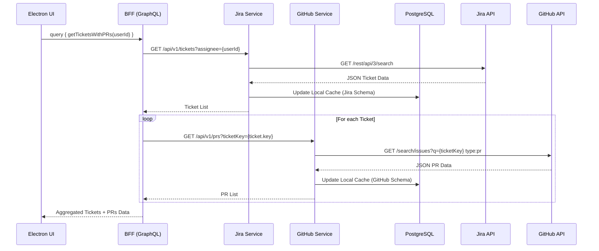
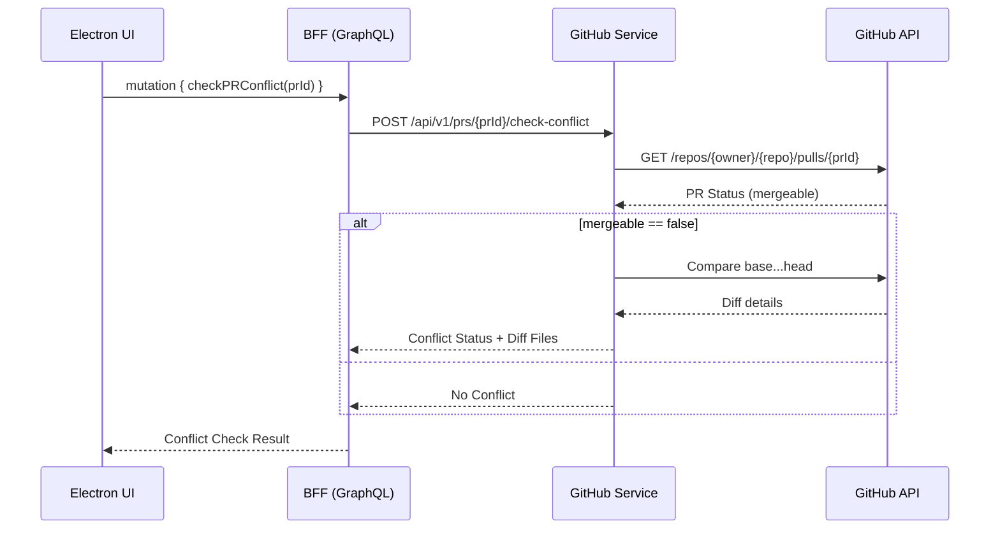
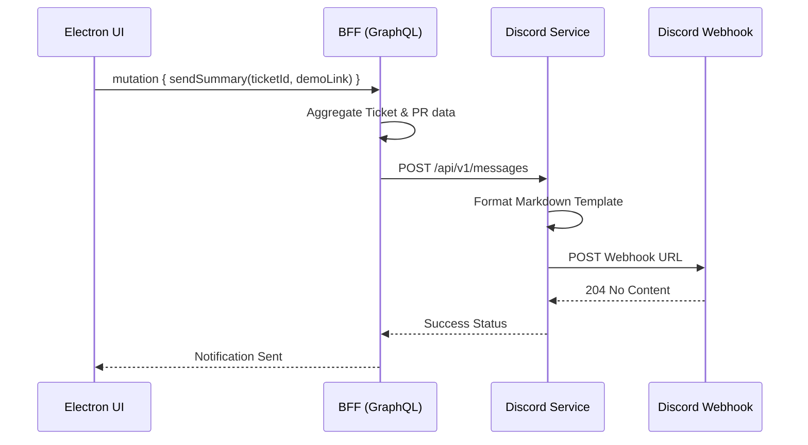

# API Request-Response Flow

This document details the end-to-end API request-response flows within the JIDIS (Jira-Discord-Github Integration System) architecture.

## Overview
The API flow follows a Backend-for-Frontend (BFF) pattern using GraphQL as the primary interface for the Electron desktop client, routing requests to appropriate downstream microservices (Jira Service, GitHub Service, Discord Service).

## 1. Ticket Fetching Flow
This flow is triggered when the dashboard loads to retrieve user-assigned tickets and their associated GitHub Pull Requests.

## 2. On-Demand Conflict Check Flow
Instead of polling constantly, the system checks for Git merge conflicts on demand when the user views PR details.

## 3. Discord Notification Flow
Triggered manually by the user to summarize the ticket and its PRs to Discord.

