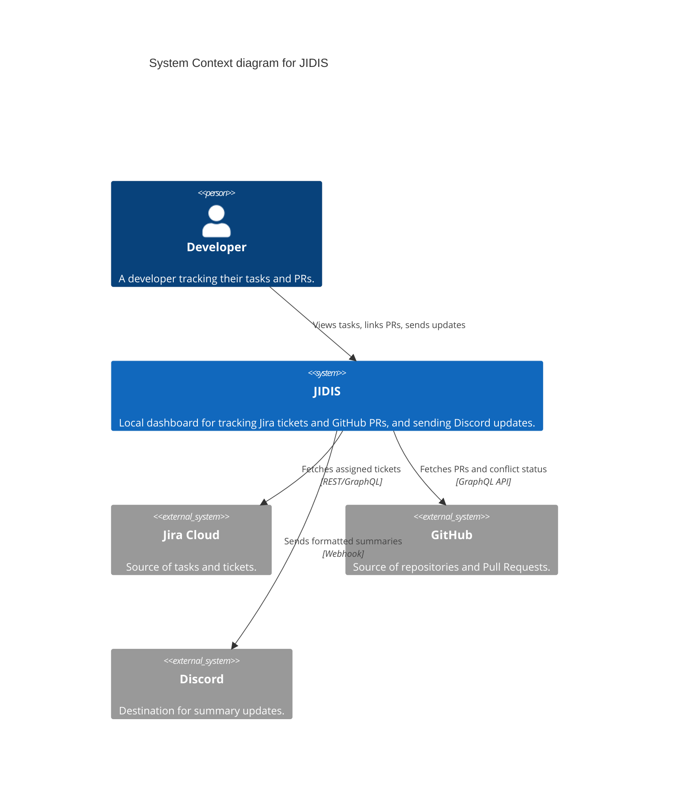
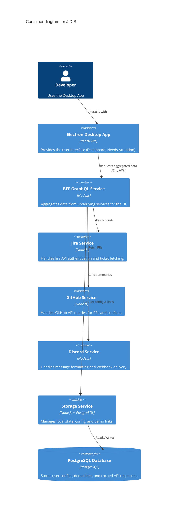

# System Architecture Overview

## 1. Architectural Style
JIDIS utilizes a **Microservice-inspired modular architecture** running locally. The system is divided into focused modules: UI, BFF (Backend for Frontend), and domain-specific services.

## 2. C4 Context Diagram

## 3. C4 Container Diagram

## 4. Data Flow Description
1. **Load Dashboard:** UI requests `DashboardData` from BFF. BFF concurrently calls `Jira Service` for tickets and `Storage Service` for cached data.
2. **Enrich Tickets:** BFF calls `GitHub Service` using Jira ticket keys to find related PRs.
3. **Display:** BFF aggregates everything and returns a unified JSON to the UI.
4. **Send Update:** UI triggers `SendDiscordSummary` via BFF. BFF retrieves ticket details + PRs + Demo links, formats the payload, and sends it to `Discord Service`.
